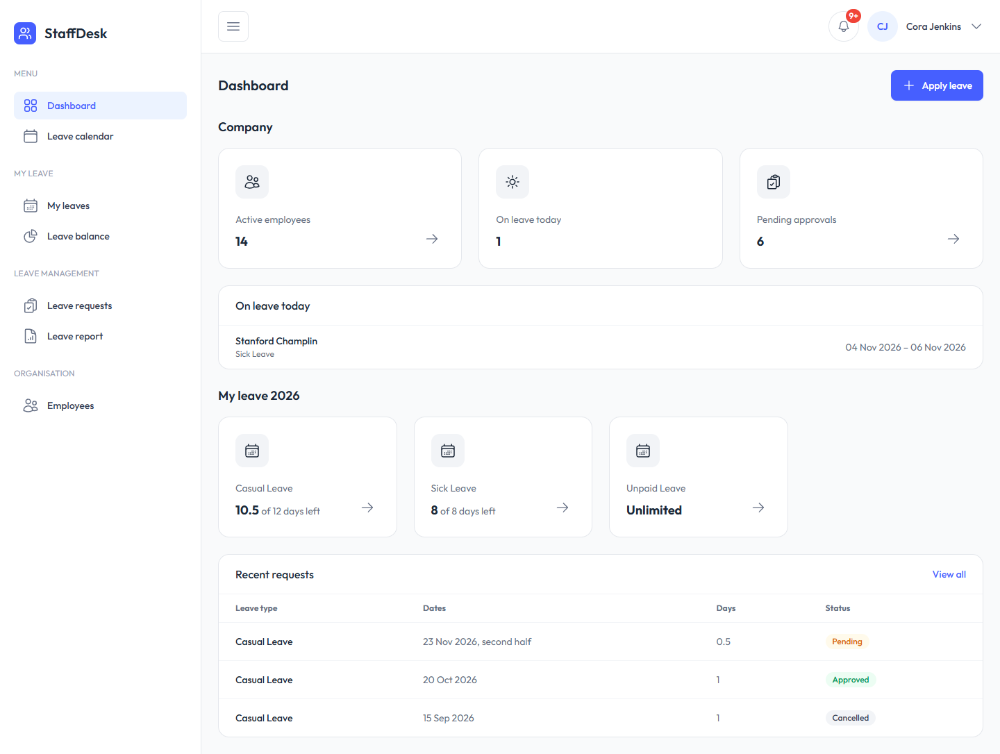
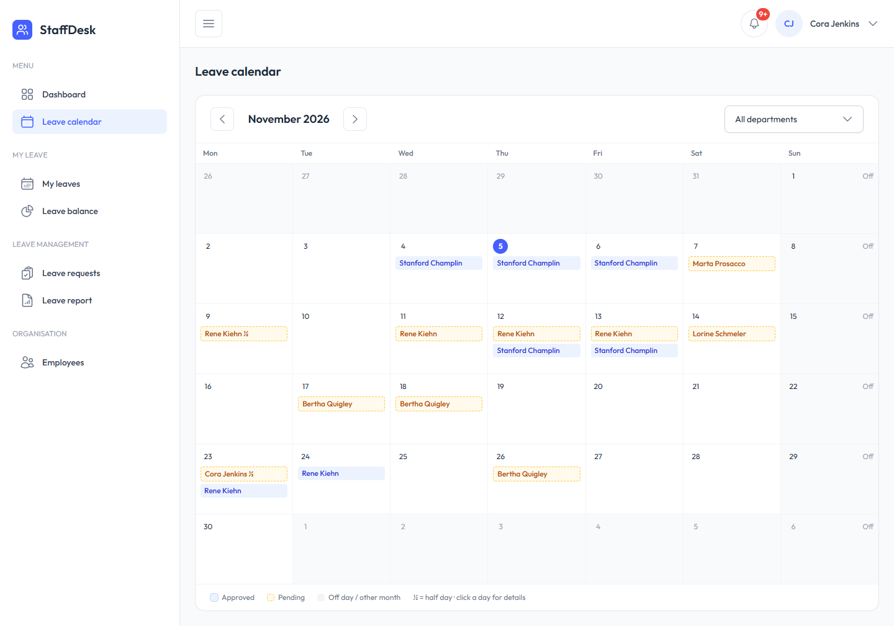
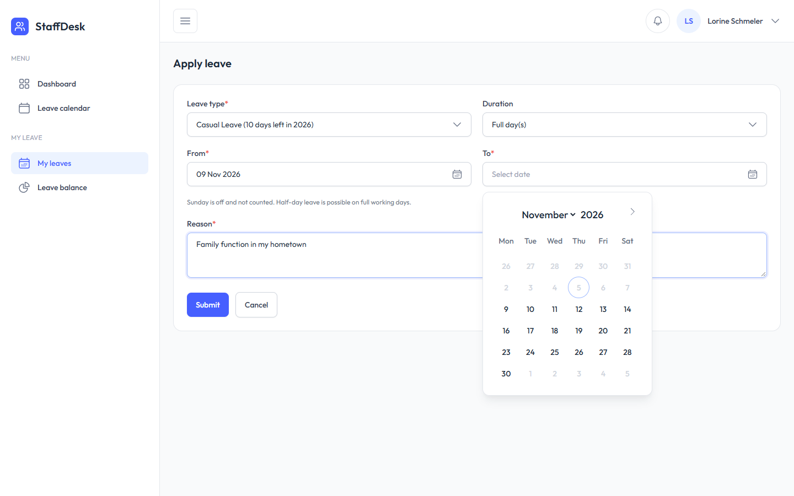
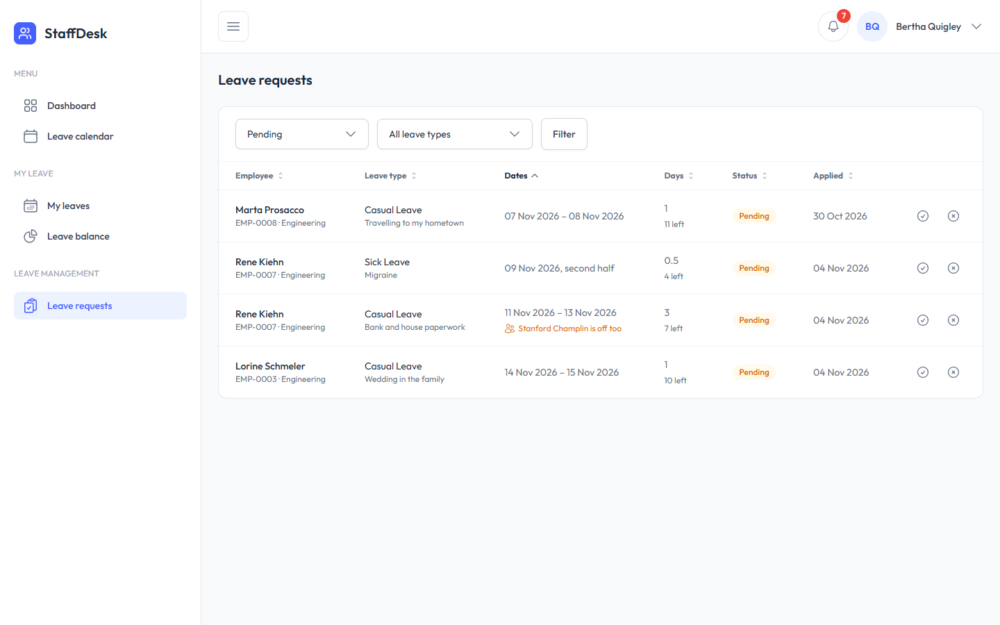
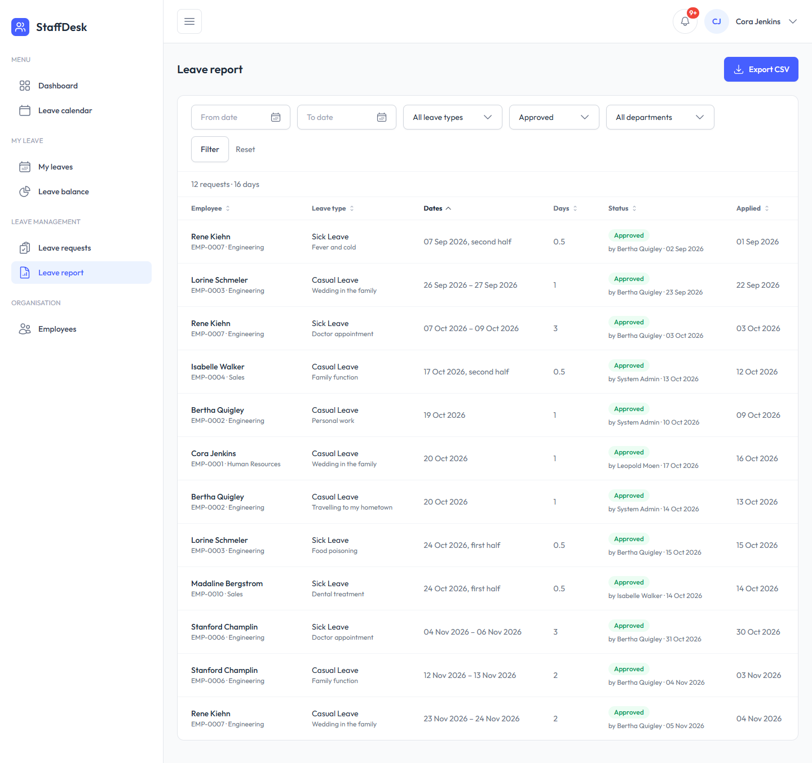
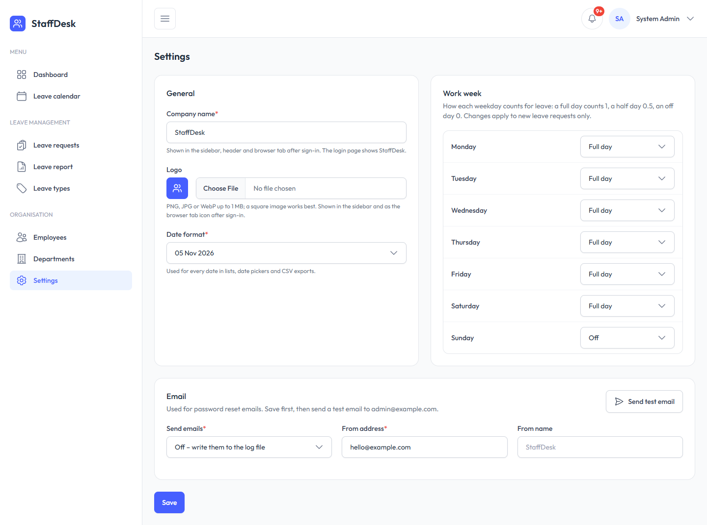

<p align="center">
    
</p>

<h1 align="center">StaffDesk</h1>

<p align="center"><strong>Leave management for small teams</strong></p>

<p align="center">
    
    
    
    
</p>

A lightweight leave management app: employees apply for leave (full or half days), managers and HR approve it, everyone sees their balance and who is off when. Four fixed roles, a work week you can set per weekday, a queued CSV report and a small REST API for a mobile app.

<table>
    <tr>
        <td></td>
        <td></td>
    </tr>
    <tr>
        <td></td>
        <td></td>
    </tr>
    <tr>
        <td></td>
        <td></td>
    </tr>
</table>

All names, emails and phone numbers in the screenshots and demo data are fake, generated by the seeder (Faker, `@example.com`, phones `+91 99999 #####`). Any match with a real person is a coincidence.

## Features

| Module | What it does |
|---|---|
| **Dashboard** | Per role: company or team numbers (people, on leave today, pending approvals), own balance and latest requests |
| **Leave** | Apply for full or half days, cancel (pending, or approved before it starts), balance per leave type, "My leaves" with filters |
| **Leave requests** | Approve / reject with a comment; each row shows the balance left and who in the team is already off those days. HR can record leave for an employee (e.g. sick leave reported by phone) |
| **Leave calendar** | Month view of pending and approved leave; click a day to see who is off (code, department, role – never the reason) |
| **Leave report** | All leave filtered by period, type, status and department, with totals; CSV export runs in a queue and arrives as a signed download link |
| **Employees & departments** | Employee profiles with generated codes, roles, activate / deactivate (a deactivated user is signed out everywhere); departments with a manager |
| **Settings** | Company name and logo (also the favicon), date format, work week (full / half / off per weekday), email via SMTP with an encrypted password and a test email |
| **Notifications** | In-app bell: new request, approved / rejected, recorded, cancelled, export ready – refreshed while the page is open |
| **API v1** | Sanctum tokens: login, logout, leave types with balance, list / apply / cancel leave |

## Roles

| Permission | Admin | HR | Manager | Employee |
|---|:-:|:-:|:-:|:-:|
| Departments, leave types, settings, activate users | ✓ | | | |
| Employees, approve any leave, record leave, reports | ✓ | ✓ | | |
| Approve leave of own department | | | ✓ | |
| Apply for leave | | ✓ | ✓ | ✓ |

Nobody approves their own leave. Admin is a system account without an employee profile.

## How leave works

1. **Apply**: pick a leave type and dates (or one half day). Days are counted from the work week: full day 1, half day 0.5, off day 0 – and stored on the request, so later work-week changes don't rewrite history.
2. **Rules** (checked in one service, shared by the web app and the API): no past dates, end on or after start, same calendar year, no overlap with your own pending or approved leave, not more than the remaining balance (pending counts as used; unlimited types skip this).
3. **Approve**: the department manager or HR/Admin approves or rejects with an optional comment; the employee is notified. Two approvers at the same moment can't both win.
4. **Balance**: quota - approved - pending, per leave type and year. Cancelled and rejected leave gives the days back.

## Architecture

- **`LeaveService`** holds every leave rule and is used by both the web controllers and the API; controllers stay thin and validation lives in Form Requests shared by web and API.
- **Policies** for every action, **enums** for statuses (`LeaveStatus`, `HalfDay`, `WorkDay`), permissions via spatie/laravel-permission – code checks permissions, never role names.
- **Queued CSV export** (`GenerateLeaveExport` job) reuses the exact query of the report page (`LeaveReportQuery`) and notifies the user with a signed, expiring download link.
- **Lists** use spatie/laravel-query-builder (allowed filters and sorts only, anything else is a 400) with plain Blade tables – no DataTables, no AJAX lists.
- **Settings** (work week, branding, email) are stored in the database, cached, and fall back to `config/staffdesk.php` / `.env`; the SMTP password is encrypted with the app key.
- **UI**: TailAdmin (Tailwind CSS v4) + Alpine.js, sidebar built from `config/menu.php`, SweetAlert2 confirms and toasts, flatpickr date pickers. Validation is server-side only.

## Built with

- PHP 8.2+, Laravel 12, MySQL 8 (tests: in-memory SQLite)
- Laravel Breeze (Blade), Sanctum, spatie/laravel-permission, spatie/laravel-query-builder
- Tailwind CSS v4 (TailAdmin), Alpine.js, Heroicons, SweetAlert2, flatpickr – built with Vite
- Pest for tests, Laravel Pint for code style

## Getting started

```bash
git clone https://github.com/kavahemal/laravel-staffdesk.git
cd laravel-staffdesk
composer install
cp .env.example .env              # set DB_USERNAME / DB_PASSWORD if needed (database: staffdesk)
php artisan key:generate
php artisan migrate --seed        # answer "yes" to create the database; then tables, roles, demo company and logins
npm install && npm run build
php artisan serve                 # http://localhost:8000
```

In a second terminal, for the CSV export:

```bash
php artisan queue:work
```

**Email**: by default emails (password reset, test email) are written to `storage/logs/laravel.log` (`MAIL_MAILER=log`). To see them in a browser, run [Mailpit](https://mailpit.axllent.org) or MailHog and set **Settings → Email** to SMTP host `127.0.0.1`, port `1025`.

### Demo logins

Password for all: `password`

| Role | Email | Sees |
|---|---|---|
| Admin | `admin@example.com` | Everything except own leave (no employee profile) |
| HR | `hr@example.com` | Employees, all leave requests, report, own leave |
| Manager | `manager@example.com` | Engineering team's requests, own leave |
| Employee | `employee@example.com` | Own leave in every status, team calendar |

## API

1. `POST /api/v1/login` with `email`, `password` (and optional `device_name`) → returns a bearer `token` (valid 30 days).
2. Send it as `Authorization: Bearer <token>` with `Accept: application/json`.
3. Use `GET /api/v1/leave-types`, `GET /api/v1/leaves`, `POST /api/v1/leaves`, `POST /api/v1/leaves/{id}/cancel`, `POST /api/v1/logout`.

Errors are always JSON (401, 403, 404, 409, 422, 429). A ready-made Postman collection with tests is in [`docs/postman_collection.json`](docs/postman_collection.json).

## Tests

```bash
php artisan test                                      # all 342 tests
php artisan test tests/Feature/LeaveCalendarTest.php  # one area: Leave, LeaveService, LeaveApproval, LeaveCalendar, Api, Settings, …
php artisan test --filter="half-day"                  # matching tests
./vendor/bin/pint --test                              # code style (Laravel Pint)
```

Tests (Pest) use an in-memory SQLite database, so they never touch the MySQL data.

## Production notes

- Use Redis for cache, sessions and the queue (locally the app uses file cache, file sessions and the database queue so nothing extra has to run).
- Keep `php artisan queue:work` running under Supervisor (or similar).
- Set `APP_ENV=production` and `APP_DEBUG=false` – Laravel Debugbar is a dev-only package.

## License

MIT – see [LICENSE](LICENSE). Free to use, change and share; keep the copyright notice. UI based on [TailAdmin](https://github.com/TailAdmin/tailadmin-laravel) (MIT); other third-party credits in [THIRD-PARTY.md](THIRD-PARTY.md).

## Author

**Hemal Kava** - [GitHub](https://github.com/kavahemal) · [LinkedIn](https://linkedin.com/in/hemal-kava)
